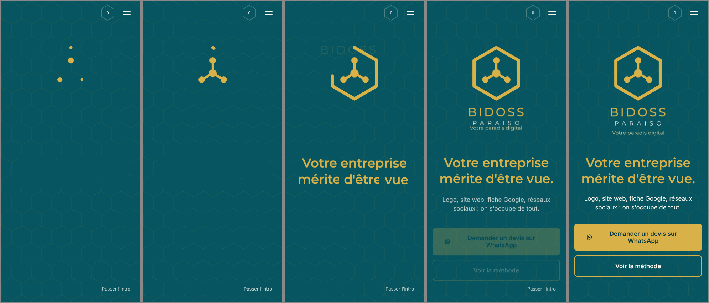
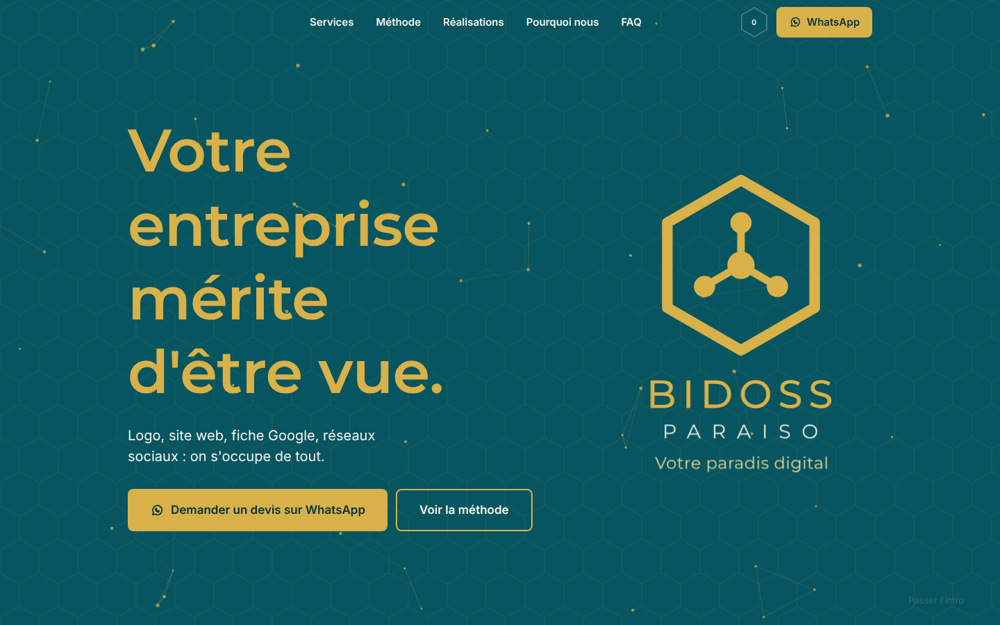
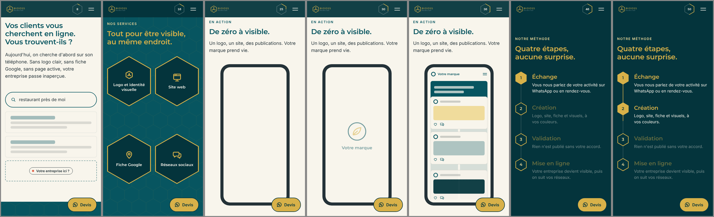
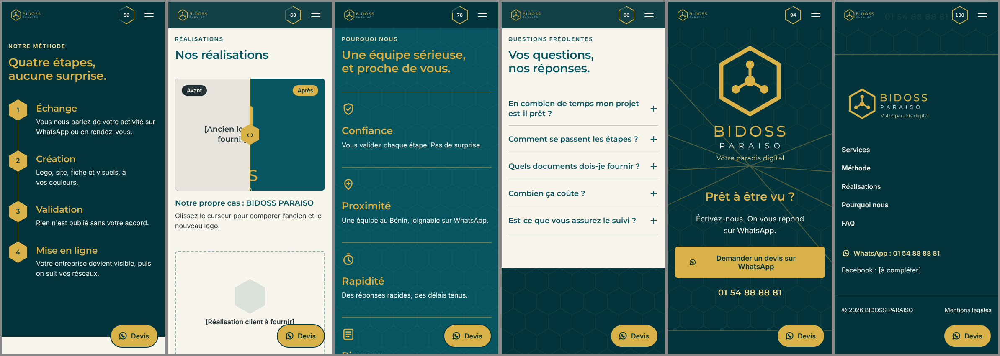
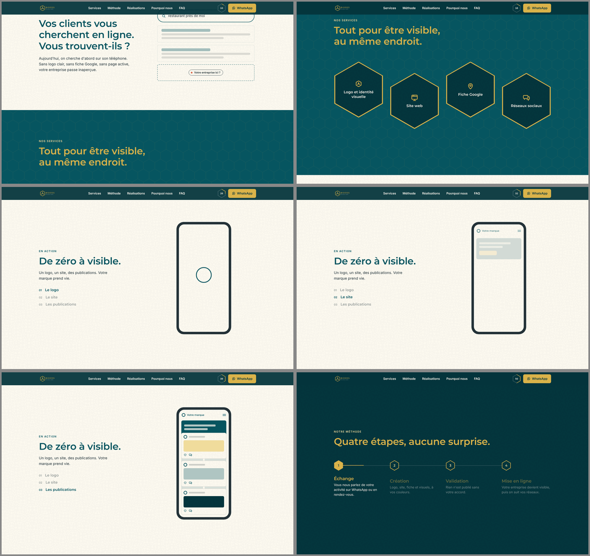
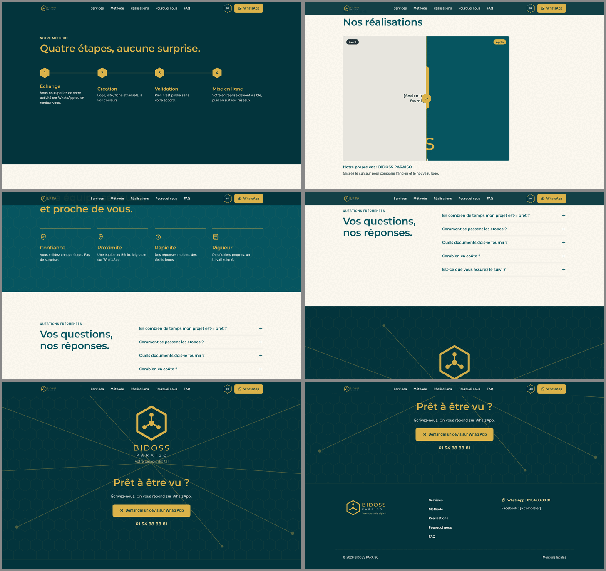
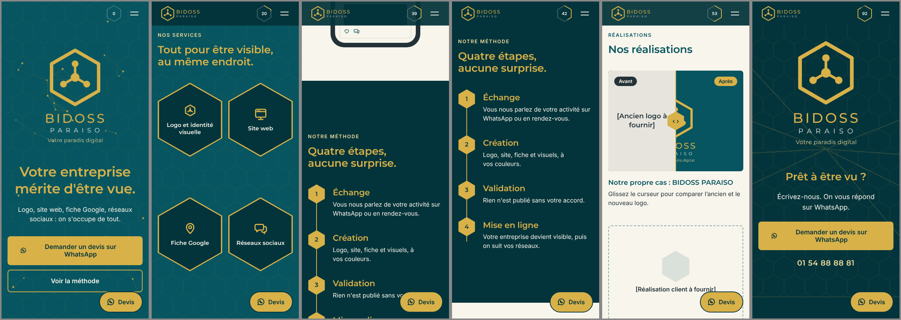
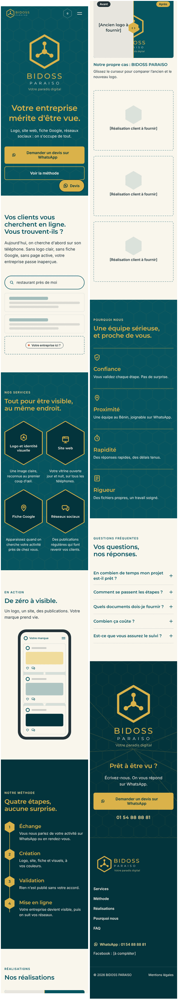

# Rapport final — site BIDOSS PARAISO

Mesures du 27/11/2026 sur la version de production (`npm run build` puis `npm run preview`),
Lighthouse 12, Chromium headless.

## Scores Lighthouse

| Profil | Performance | Accessibilité | Bonnes pratiques | SEO |
|---|---|---|---|---|
| **Mobile** (4G lente simulée, processeur ×4) | **100** | **100** | **100** | **100** |
| Desktop | 100 | 100 | 100 | 100 |

Rapports complets : [mobile](captures/lighthouse-mobile.html) · [desktop](captures/lighthouse-desktop.html).

Le profil mobile de Lighthouse correspond exactement au test demandé « 4G lente + CPU ×4 » :
150 ms de latence, 1,6 Mb/s, processeur ralenti 4 fois.

## Budgets

| Budget | Objectif | Mesuré | |
|---|---|---|---|
| LCP (4G lente) | < 2,5 s | **1,7 s** | OK |
| CLS | < 0,05 | **0** | OK |
| Temps de blocage (indicateur de l'INP en labo) | INP < 200 ms | **30 ms** de TBT | OK |
| JavaScript total (gzip) | < 120 Ko | **≈ 54 Ko** (2,9 Ko immédiat + 51,5 Ko chargés ensuite) | OK |
| Poids de la page d'accueil | < 1 Mo | **165 Ko** transférés, 10 requêtes | OK |
| Contrastes WCAG AA | partout | 16 paires contrôlées par `npm run contrastes` | OK |

L'INP réel ne se mesure qu'avec de vrais visiteurs. En labo, le temps de blocage de 30 ms
laisse une large marge sous les 200 ms.

## Ce qui rend le site rapide
- L'intro du logo est en **CSS pur** : elle commence à la première image, sans attendre le JavaScript.
- Le titre est peint dès la première image (un volet couleur fond se retire), donc l'animation ne retarde pas le LCP.
- GSAP, ScrollTrigger et Lenis ne sont chargés **qu'après** l'affichage, quand le navigateur est libre.
- Le fond « réseau » est un canvas 2D (60 nœuds max sur mobile) qui se met en pause hors écran et onglet caché.
- Polices auto-hébergées en woff2 latin, les deux principales préchargées.
- CSS et logos SVG intégrés dans la page : aucun aller-retour réseau en plus pour l'affichage.
- L'image « après » est servie en AVIF ou WebP, en 3 tailles, chargée seulement à l'approche.

## Captures

### Intro du hero (mobile, à 0,2 s · 0,7 s · 1,2 s · 1,8 s · 2,6 s)

### Hero desktop (fin de l'intro)

### Sections, mobile 390 × 844

### Sections, desktop 1440 × 900

### Mouvement réduit (prefers-reduced-motion)
Tout est visible immédiatement, le réseau est fixe, les étapes de la méthode sont allumées.

### Sans JavaScript
La page complète reste lisible et les boutons WhatsApp fonctionnent.

## Points restant ouverts
- Contenus à fournir : voir [`CONTENU_A_FOURNIR.md`](../CONTENU_A_FOURNIR.md) (ancien logo, 3 réalisations, réponses FAQ, mentions légales, domaine).
- À tester sur un vrai Android d'entrée de gamme une fois en ligne (Lighthouse simule, il ne remplace pas un vrai téléphone).
